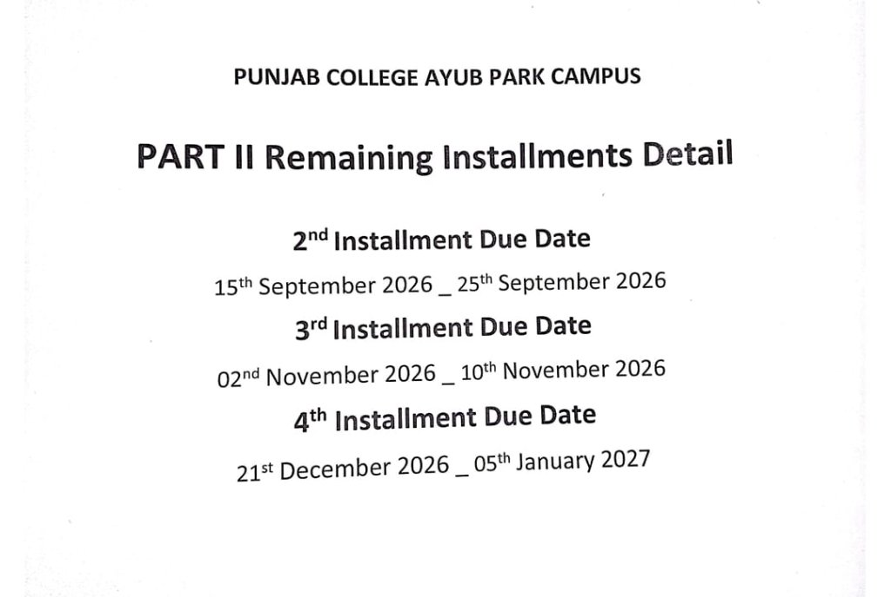

# 📊 Attendance Planner (v3.0.7)

> **Know exactly how many days you can safely miss and still stay above your target attendance (default 80% or any custom %).**  
> Built for students of Punjab Group of Colleges (PGC) with 1-click portal scraping, group cloud sync, and smart exam protection.

---

## ⚖️ Legal Disclaimer & Notice

> [!WARNING]
> **Important Notice:**
> Attendance Planner is an independent, open-source student helper tool. It is **NOT** officially affiliated with, endorsed by, or operated by Punjab Group of Colleges (PGC) or the Punjab Group of Educational Institutes.
> 
> * **Personal Responsibility:** Calculations, date estimates, and recommended absence cushions are purely mathematical projections based on records displayed on your student portal (`my.pgc.edu`) and user-configured section timetables. Campus administration delays in posting attendances, retroactive attendance adjustments, surprise schedule changes, or college policies can affect your official standing.
> * **No Liability:** The authors, contributors, and maintainers of this project accept **zero liability or responsibility** for any lost scholarships, altered fee concessions, fines, academic penalties, exam detentions, or disciplinary measures resulting from attendance shortages or reliance upon this software.
> * **Always Verify:** You are solely responsible for ensuring you satisfy your campus's official criteria. Always confirm critical fee installment cut-off dates, examination schedules, and official attendance records directly with your campus administration and section coordinators.

---

## ✨ Features at a Glance

* 🎯 **Custom Target Safety Guarantee:** Calculates the exact maximum number of days and lectures you can miss without dropping below your target percentage (default 80% cutoff, or customized to whatever your college requires).
* ⚡ **1-Click Portal Scrape:** Tap **Calculate** while on `my.pgc.edu/attend` to instantly pull your real-time attendance figures.
* ✨ **Simple Mode (Default):** Clean, distraction-free view with only what matters:
  * Days you can safely miss
  * Total skippable lecture cushion
  * Projected attendance percentage
  * Present / Absent / Leaves / Remaining breakdown
  * Section schedule summary (upcoming exams, prep study offs, official holidays)
* 🛠️ **Advanced Mode:** Power controls for section admins & organizers:
  * Customizable target attendance cutoff (default 80%, adjustable to any %)
  * Custom planned leaves calendar
  * Exam date & prep study off editor
  * Fee installment cutoff manager
  * Group permission manager (Admin, Editor, Student)
* 🏖️ **Absence Strategy Switcher:**
  * **Max Days (Lightest 1st):** Prioritizes days with fewer lectures (e.g. 5-lecture Thursdays with attendance-free tutorial periods, or 4-lecture Saturdays) to get the highest total number of whole days off.
  * **Heavy Days (Heaviest 1st):** Prioritizes heavy 6-lecture days (Mon–Wed, Fri–Sat) so you skip exhausting packed schedules first.
* 📝 **Exam & Prep Off Protection:** Exams count as 1 lecture, and study prep days count as 0 lectures. Both are automatically protected from absence recommendations.
* 🌐 **Dedicated Cloud Tab & Real-Time Sync:** One student or CR inputs the exam dates and holidays—everyone in the section syncs automatically in real-time.

---

## 🚀 1-Click Installation Guide

No manual ZIP extracting or terminal knowledge needed! The 1-click script downloads and sets up everything for you.

### 🪟 Windows Setup (Easiest)

1. **Create an empty folder** anywhere on your computer (e.g. `Documents\Attendance`).
2. **Download [`windows-update.bat`](https://raw.githubusercontent.com/Colaup747/attendance-calc/main/windows-update.bat)** and place it into that folder.  
   *(Tip: Right-click the link above $\rightarrow$ **Save link as...** $\rightarrow$ save into your new folder).*
3. **Double-click `windows-update.bat`**.
   * It will download the latest version, unpack all required files, and open Chrome's Extensions page automatically!
4. **Load into Google Chrome:**
   * In Chrome, turn **ON** the **Developer mode** toggle in the top-right corner.
   * Click the **Load unpacked** button in the top-left corner.
   * Select your `Attendance` folder!
5. **Pin the extension:** Click the puzzle icon 🧩 in Chrome's top bar and pin **Attendance Planner** 📌!

---

### 🍎 macOS Setup

1. **Create an empty folder** (e.g. `Documents/Attendance`).
2. **Download [`mac-update.command`](https://raw.githubusercontent.com/Colaup747/attendance-calc/main/mac-update.command)** into that folder.
3. **Double-click `mac-update.command`**.
   * If macOS shows an *unidentified developer* warning: Right-click the file $\rightarrow$ select **Open** $\rightarrow$ click **Open**.
4. In Google Chrome (`chrome://extensions`):
   * Enable **Developer mode** in the top-right corner.
   * Click **Load unpacked** and select your `Attendance` folder.
5. Pin **Attendance Planner** 📌 to your toolbar!

---

### 🐧 Linux Setup

1. **Create an empty folder** on your computer:
   ```bash
   mkdir -p ~/attendance && cd ~/attendance
   ```
2. **Download [`linux-update.sh`](https://raw.githubusercontent.com/Colaup747/attendance-calc/main/linux-update.sh)** into that folder:
   ```bash
   curl -s -L "https://raw.githubusercontent.com/Colaup747/attendance-calc/main/linux-update.sh" -o linux-update.sh && chmod +x linux-update.sh
   ```
3. **Run `./linux-update.sh`**.
   * It will download the latest version, unpack all extension files, and launch Chrome or Chromium to `chrome://extensions`.
4. In Chrome / Chromium (`chrome://extensions`):
   * Enable **Developer mode** in the top-right corner.
   * Click **Load unpacked** and select your `~/attendance` folder.
5. Pin **Attendance Planner** 📌 to your toolbar!

---

## ⚡ How to Update (1-Click)

Whenever a new update is released, you will see an **Update Available** banner inside the extension:

1. Open your `Attendance` folder.
2. Open the **`updater`** folder and run:
   * **Windows:** Double-click `windows-update.bat`
   * **macOS:** Double-click `mac-update.command`
   * **Linux:** Run `./linux-update.sh`
3. Tap **⟳ Reload** inside the extension banner or in Chrome extensions!

That's it! All your attendance data, custom settings, and synced schedules are safely preserved across updates.

---

## 📖 How to Use

### 1. Basic Attendance Calculation
1. Log into your PGC student portal at [**`my.pgc.edu/attend`**](https://my.pgc.edu/attend).
2. Click the **Attendance Planner** icon in your Chrome toolbar.
3. Tap **⟳ Calculate**.
4. The extension instantly computes:
   * **You Can Safely Miss:** Whole days you can take off without dropping below your target percentage (e.g. 80%).
   * **Lectures Skippable Total:** Your exact lecture safety cushion.
   * **Projected Attendance:** What your final percentage will be if you miss those days.
5. Tap **🏖️ Max Days** or **⚡ Heavy Days** to switch between maximizing total days off or skipping heavy 6-lecture days first.

---

## 🎓 Understanding PGC Fee Installments & Cut-Off Dates

In Punjab Group of Colleges (PGC), maintaining your scholarship (e.g. 80%, 85%, or fee concession) requires meeting the required attendance percentage across each installment evaluation period.

---

### 🟢 1st Year (Part I) Students

* **1st Installment:** Paid at the time of admission. It is **not** based on college attendance (since college hasn't started yet), but was granted based on your **Matric / SSC board marks**.
* **2nd Installment:** Evaluated from your **Day 1 of college** $\rightarrow$ **the day before you receive the 2nd challan**.
* **3rd Installment:** Evaluated from **the day you receive the 2nd challan** $\rightarrow$ **the day before you receive the 3rd challan**.
* **4th Installment:** Evaluated from **the day you receive the 3rd challan** $\rightarrow$ **the day before you receive the 4th challan**.
* **🔥 Scholarship Continuation into 2nd Year (Crucial!):**  
  Starting **the day you receive the 4th challan** in 1st year $\rightarrow$ **to the very last day of your 1st year session** (including send-up exams). Your attendance in this period determines whether your scholarship/concession continues into **2nd Year (Part II 1st Installment)**!

| 1st Year Window | Attendance Duration Evaluated | What It Decides |
| :--- | :--- | :--- |
| **1st Installment** | Paid at admission (based on SSC marks) | Initial Admission Concession |
| **2nd Installment** | Day 1 of college $\rightarrow$ Day before 2nd challan | 2nd Installment Fee Concession |
| **3rd Installment** | Day 2nd challan received $\rightarrow$ Day before 3rd challan | 3rd Installment Fee Concession |
| **4th Installment** | Day 3rd challan received $\rightarrow$ Day before 4th challan | 4th Installment Fee Concession |
| **Post-4th Challan** | Day 4th challan received $\rightarrow$ End of 1st year session | **Scholarship for 2nd Year (Part II 1st Installment)!** |

---

### 🔵 2nd Year (Part II) Students

* **1st Installment:** Evaluated on your attendance from the end of 1st year (the day you got your 4th challan until the 1st year session finished).
* **2nd Installment:** Evaluated from **Day 1 of 2nd year** $\rightarrow$ **the day before you receive the 2nd challan**.
* **3rd Installment:** Evaluated from **the day you receive the 2nd challan** $\rightarrow$ **the day before you receive the 3rd challan**.
* **4th Installment:** Evaluated from **the day you receive the 3rd challan** $\rightarrow$ **the day before you receive the 4th challan**.

| 2nd Year Window | Attendance Duration Evaluated | Example (From Ayub Park Campus Notice) |
| :--- | :--- | :--- |
| **2nd Installment** | Day 1 of 2nd year $\rightarrow$ Day before 2nd challan | Reopening $\rightarrow$ **14 September** (if 2nd challan is 15 Sep) |
| **3rd Installment** | Day 2nd challan received $\rightarrow$ Day before 3rd challan | Sep 15 $\rightarrow$ **01 November** (if 3rd challan is 02 Nov) |
| **4th Installment** | Day 3rd challan received $\rightarrow$ Day before 4th challan | Nov 02 $\rightarrow$ **20 December** (if 4th challan is 21 Dec) |

---

### 📸 Real Campus Notice Example (Ayub Park Campus)

Here is a real example of a PGC remaining installments notification notice:

<p align="center">
  
</p>

#### 🔍 Labeled Breakdown of Challan Dates vs Attendance Cut-Offs:
From the notification notice above, we can see how the official attendance cut-off dates are determined:

1. **2nd Installment Due Date:** `15th September 2026 _ 25th September 2026`
   * **Challan Issued On:** 15 September 2026
   * **Attendance Cut-Off:** **14 September 2026** *(the day before the 2nd challan is issued)*.
   * **Covers:** Day 1 of college reopening until 14 September.

2. **3rd Installment Due Date:** `02nd November 2026 _ 10th November 2026`
   * **Challan Issued On:** 02 November 2026
   * **Attendance Cut-Off:** **01 November 2026** *(the day before the 3rd challan is issued)*.
   * **Covers:** 15 September until 01 November.

3. **4th Installment Due Date:** `21st December 2026 _ 05th January 2027`
   * **Challan Issued On:** 21 December 2026
   * **Attendance Cut-Off:** **20 December 2026** *(the day before the 4th challan is issued)*.
   * **Covers:** 02 November until 20 December.

4. **Scholarship Continuation for 2nd Year (Part I Students):**
   * **Starts:** 21 December 2026 (the day the 4th challan is received).
   * **Ends:** Final day of your 1st year session (send-up exams & college close).

---

### 🔧 How to Adjust Your Installment Cut-Off Dates in the App
Because different PGC campuses issue challans on slightly different dates, you can adjust your dates anytime:
* **Quick Change:** Simply change the **Window end** date picker in the top bar!
* **Full Window Management:**
  1. Click **🛠️ Advanced** in the top bar.
  2. Go to the **⚙️ Settings** tab $\rightarrow$ scroll down to **Fee-Installment Windows**.
  3. Edit the start and end dates to match your campus schedule, or click **+ Add Window**.

---

## ⏰ How to Customize Lectures Per Day (Your Section Timetable)

> 💡 **Why this is important:** Not every campus or section has the exact same timetable!
> * Some campuses have **Thursdays as 5 lectures** because of an attendance-free "tutorial" or advisory period.
> * Other sections have **Saturdays as 4 lectures**, **Mondays as 5 lectures**, and other days as 6 lectures depending on student subjects, practical labs, or campus policy.
>
> Attendance Planner lets you adjust the exact number of attendance-counted lectures for every single day of the week!

### 🔧 Step-by-Step Tutorial: Adjusting Lectures Per Day
1. Click **🛠️ Advanced** in the top bar to switch to Advanced Mode.
2. Go to the **⚙️ Settings** tab.
3. Scroll down to the **Lectures Per Day** section.
4. You will see inputs for all 7 days:
   `[ Sun ] [ Mon ] [ Tue ] [ Wed ] [ Thu ] [ Fri ] [ Sat ]`
5. Enter the exact number of lectures you have on each day (e.g., `Mon: 6`, `Tue: 6`, `Wed: 6`, `Thu: 5`, `Fri: 6`, `Sat: 4`, `Sun: 0`).
6. Click **Calculate**! The extension will immediately recalculate your whole days and lecture cushion based on your section's customized schedule.

> 🌐 **Section Cloud Sync:** If you are the Class Representative or Section Admin, any updates you make to Lectures Per Day will automatically sync to all your classmates when you tap **Publish Changes** in the **🌐 Cloud** tab!

---

## 🗓️ Adding Exams, Prep Leaves & Official Holidays

Attendance Planner lets you model your real college timetable so you never miss an exam or get penalized for study holidays:

### 📝 1. Exam Days
* Switch to **🛠️ Advanced** $\rightarrow$ go to the **📝 Exams** tab.
* Tap dates on the calendar to mark them as **Exams** (highlighted in purple).
* **How it calculates:** An exam day is treated as **1 lecture** (instead of 6 lectures) and will **never** be suggested as a day to skip.

### 📚 2. Prep Leaves (Study Offs Between Exams)
* In the **📝 Exams** tab, check the list below the calendar.
* Between exams, college often gives self-study preparation days. Check the box next to any day to mark it as **Prep Off** (0 lectures).
* **How it calculates:** Prep leaves are counted as 0 lectures so they will not reduce your attendance safety cushion!

### 🏖️ 3. Official Holidays & College Trips
* Switch to **🛠️ Advanced** $\rightarrow$ go to the **⚙️ Settings** tab $\rightarrow$ **Active Holidays**.
* Tap dates to mark public holidays, national days (e.g. Kashmir Day, Iqbal Day), or college trip days.
* **How it calculates:** College holidays count as 0 lectures.

### ✈️ 4. Personal Planned Leaves
* Go to the **🏖️ Leaves** tab.
* Mark any specific days you already know you will take off (weddings, family events, personal trips).
* The planner subtracts those days and tells you how many *additional* days you can still safely miss.

---

## 🌐 Class Section Cloud Sync (The 🌐 Cloud Tab)

Share your section's exam dates and study leaves so only one student needs to enter them:

> 🟢 **Pre-Configured Cloud Database:** Attendance Planner comes with a shared, high-speed cloud database ready out of the box (as confirmed by the live **🟢 Cloud Database: Connected & Operational** status badge). Setting up a custom Firebase URL is strictly optional for advanced users who wish to run their own private database instance.

### 👥 For Students (Joining an Existing Section):
1. Click **🛠️ Advanced** in the top bar $\rightarrow$ go to the **🌐 Cloud** tab.
2. Under **👥 Join Section Group**, enter your **Section Code** (e.g. `ICS-2A` or `FSC-1B`), your **Name / Roll No**, and a **4-digit PIN**.
3. Tap **🔐 Join Section**.
4. Your extension will instantly pull all exam dates, prep offs, and holidays set up for your class!

### 👑 For Class Representatives / Admins (Creating a New Group):
1. Go to the **🌐 Cloud** tab.
2. Click the **➕ Create New Group** sub-tab.
3. Enter your **New Section Code** (e.g. `ICS-2A`), your **CR Name**, and an **Admin PIN**.
4. Tap **👑 Create Group**.
5. Your current exam dates and holidays will automatically seed the cloud database.
6. Share the section code with your classmates so they can join!

### ☁️ Saving & Syncing Changes
* When logged in, any admin or authorized student can tap **☁️ Save Changes to Cloud** in the **📝 Exams** tab or **Publish Changes** in the **🌐 Cloud** tab.
* All classmates in the section will receive the updated dates automatically on their next open or calculate!

---

## 🔒 Privacy & Security

* **100% Client-Side:** Calculations run directly in your browser.
* **No Password Storage:** Portal credentials are never collected, stored, or transmitted.
* **Open Source:** You can inspect all files (`popup.js`, `calc.js`, `content.js`) right in this repository.

---

## 🤝 Open Source & Contributions

* **Repository:** [github.com/ColaUp747/attendance-calc](https://github.com/ColaUp747/attendance-calc)
* Questions, bug reports, or suggestions? Open an Issue or submit a Pull Request on GitHub!
